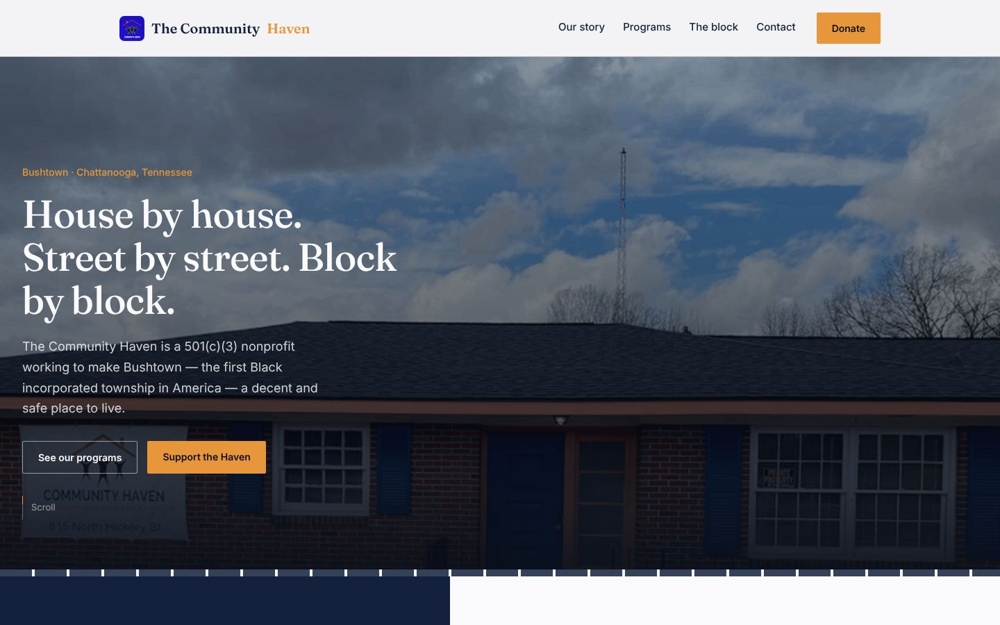

# The Community Haven website

The website for **The Community Haven**, a 501(c)(3) nonprofit working to make Bushtown in Chattanooga, Tennessee (the first Black incorporated township in America) a decent and safe place to live.

**Live site:** https://communityhavenchattanooga.org

Designed and built by [Jason McElvain](https://github.com/MacSupportPlus).



## What changed
- Rebuilt by hand from a page-builder site that was tied to its hosting company
- New homepage around the neighborhood's story, a team page, and 11 program pages
- The organization's real logo, photos, and branding throughout
- Mobile-first, with an accessible navigation menu and contact form

## The move
The new site was built on a temporary address while the old one stayed live. After sign-off, the DNS cache time was lowered ahead of time, the domain was pointed at Netlify, and SSL was verified, so visitors never hit a dead site. The domain was moved to Cloudflare Registrar so the organization owns it outright.

## Stack
Plain HTML, CSS, and JavaScript · Netlify · Cloudflare DNS

## Project layout
```
index.html          Homepage: story, programs, the block, contact
team.html           Leadership and staff
programs/           11 program pages (Community Patrol, Camp Haven, Girls Academy, ...)
events.html, donate.html, contact.html
css/styles.css      One stylesheet, no framework
js/main.js          Mobile menu, scroll reveals, contact form
images/             The organization's own photos and logo
```

No build step: open `index.html` in a browser, or deploy the folder as-is to any static host.
